# Arquitectura — Gasolinera Río Tempisque

Documento de referencia para entender **cómo está armado el proyecto**, **cómo fluyen los datos** y **cómo escalarlo sin convertir el código en spaghetti**.

Stack: **Next.js App Router (TypeScript)** + **Supabase (Auth + PostgreSQL + RLS + RPC)** + UI en el mismo monorepo.

---

## 1. Visión general

La aplicación es un **monolito modular full-stack**:

- Next.js sirve pantallas (Server Components), mutaciones (Server Actions) y algunas API routes.
- Supabase Auth mantiene sesiones en cookies (SSR).
- PostgreSQL es la **autoridad** de permisos, PIN, marcaciones, planilla, auditoría y cierres.
- No hay un backend FastAPI/Nest aparte: la “API de negocio dura” vive en **RPC SQL**.

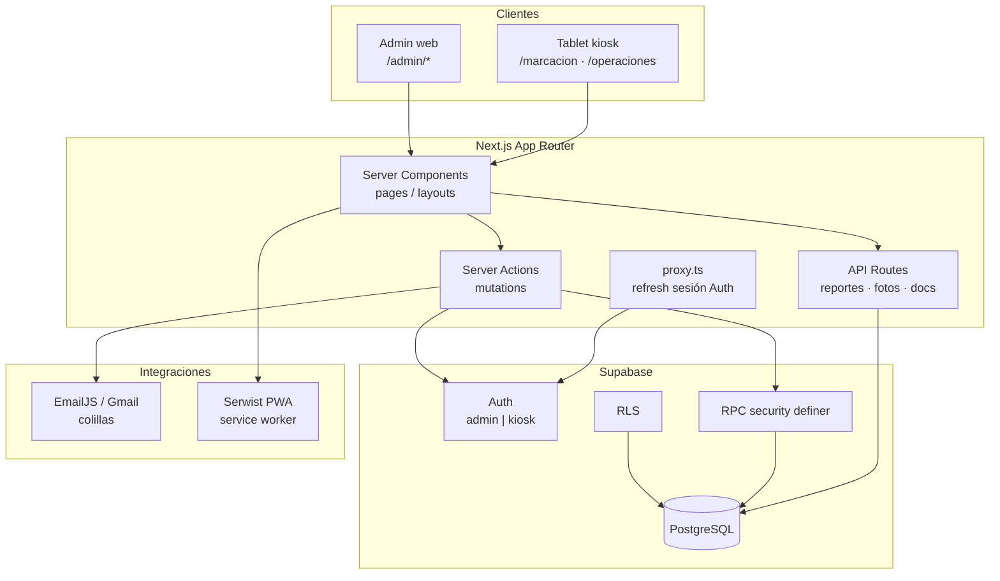

---

## 2. Capas (para no mezclar responsabilidades)

| Capa | Ubicación | Qué hace | Qué NO debe hacer |
|---|---|---|---|
| **UI / Presentación** | `src/app/**`, `src/components/**` | Mostrar datos, formularios, modales | Calcular OT, cerrar planilla, hashear PIN |
| **Aplicación** | `src/app/**/actions.ts` | Orquestar: validar → RPC/query → revalidate | SQL crudo complejo, reglas legales |
| **Dominio / utils** | `src/lib/**` | Zod, formato CRC, labels, mail HTML | Acceder a cookies/UI |
| **Infra** | `lib/supabase`, EmailJS, Serwist | Clientes externos | Lógica de negocio |
| **Persistencia + reglas** | `supabase/migrations/**` | Tablas, RLS, RPC, triggers, auditoría | Depender de React |

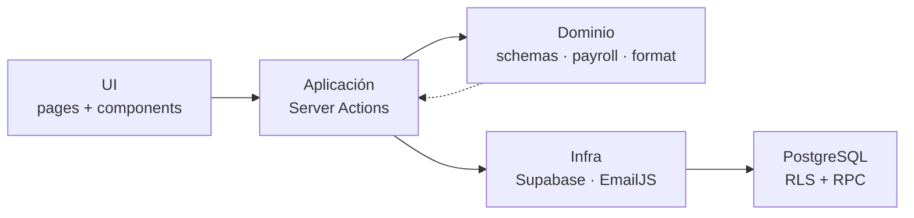

**Regla de oro:** si una regla afecta dinero, seguridad o cierre de período, debe vivir en **RPC/SQL** (o al menos validarse ahí), no solo en un componente React.

---

## 3. Mapa de carpetas

```text
src/
  app/
    marcacion/          # Terminal asistencia (kiosk)
    operaciones/        # Tareas e incidentes (kiosk + PIN empleado)
    admin/              # Panel administrativo
      actions.ts        # Mutaciones admin “core”
      ops-actions.ts    # Mutaciones de operaciones
      recordatorios/    # Feature con actions propias
      planilla/         # Quincenas, reporte, aguinaldo, historial
    api/                # CSV, fotos, documentos
    login/
  components/           # UI reutilizable (directorios, shell, KPI…)
  lib/                  # Dominio + infra (auth, schemas, payroll, mail)
  proxy.ts              # Refresh de sesión Supabase
supabase/migrations/    # Fuente de verdad del esquema y RPCs
tests/                  # Vitest + PGlite
docs/                   # Este documento y notas
```

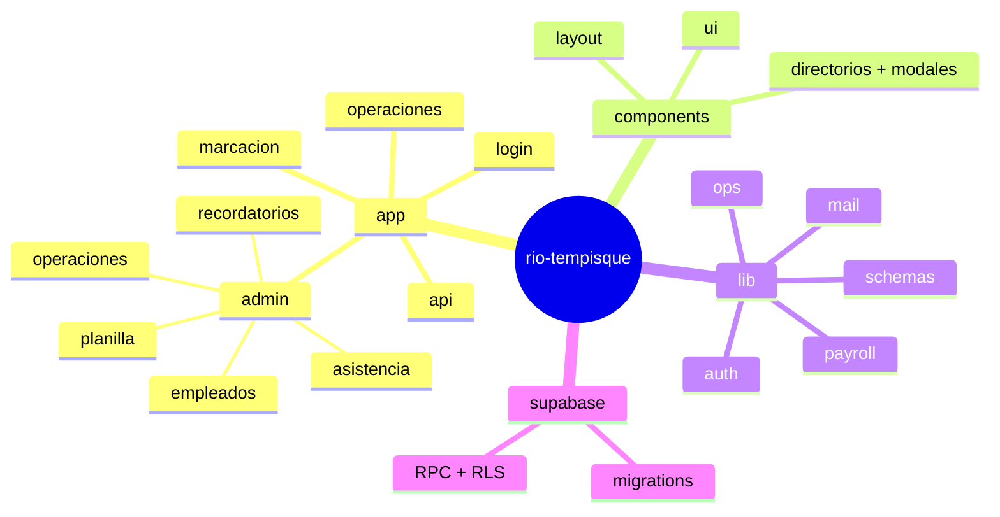

---

## 4. Autenticación y roles

Hay dos roles de Auth (`profiles.role`):

- **`admin`** — panel `/admin/*`
- **`kiosk`** — tablet `/marcacion` y puerta de entrada a `/operaciones`

Además, en operaciones el **empleado** se identifica con **código + PIN** (cookie `grt_ops_session`), independiente de Auth.

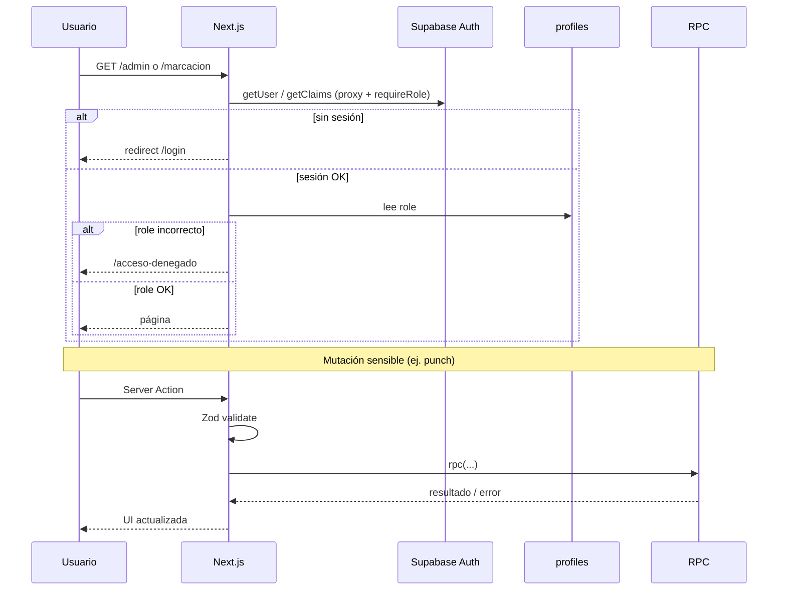

Gatekeeper central: `src/lib/auth.ts` → `requireRole("admin" | "kiosk")`.

---

## 5. Flujo de mutación (patrón estándar)

Todas las escrituras deberían seguir este camino:

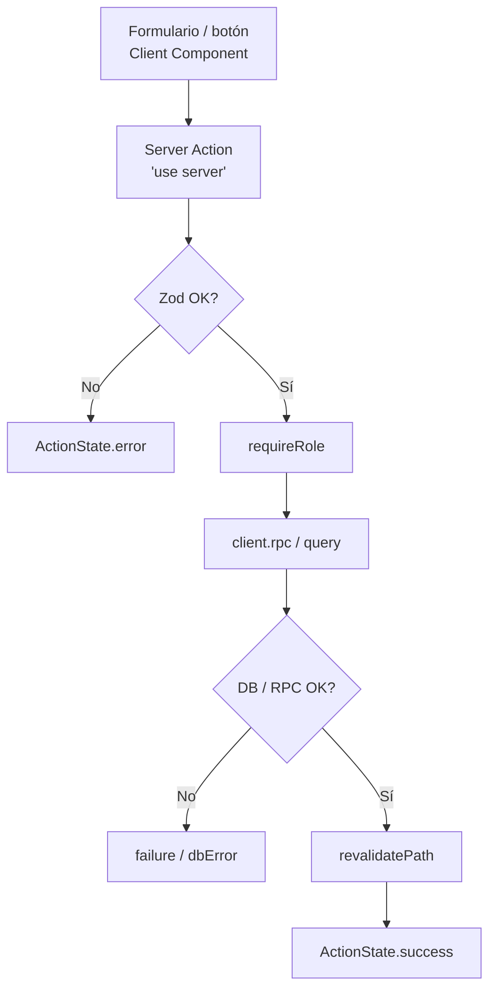

Helpers de UI: `ActionForm` (`useActionState`) para feedback de error/éxito sin spaguetti de fetch.

---

## 6. Dominios principales

### 6.1 Asistencia (marcación)

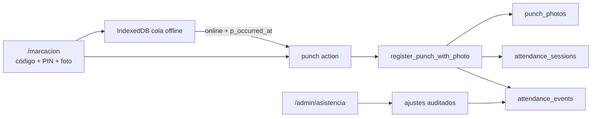

- Eventos = evidencia original.
- Sesiones = vista derivada (entrada / descansos / salida).
- Online: hora de servidor. Offline: cola IndexedDB + `p_occurred_at` (ventana acotada). PIN con bcrypt; idempotencia por `requestId`.
- Admin puede **ajustar** (`correct_session`) o **borrar** jornada / solo salida (`delete_attendance_session`, con motivo y `audit_log`; bloqueado si planilla cerrada).
- Detalle PWA/cola: `docs/pwa.md` §8.

### 6.2 Operaciones de estación

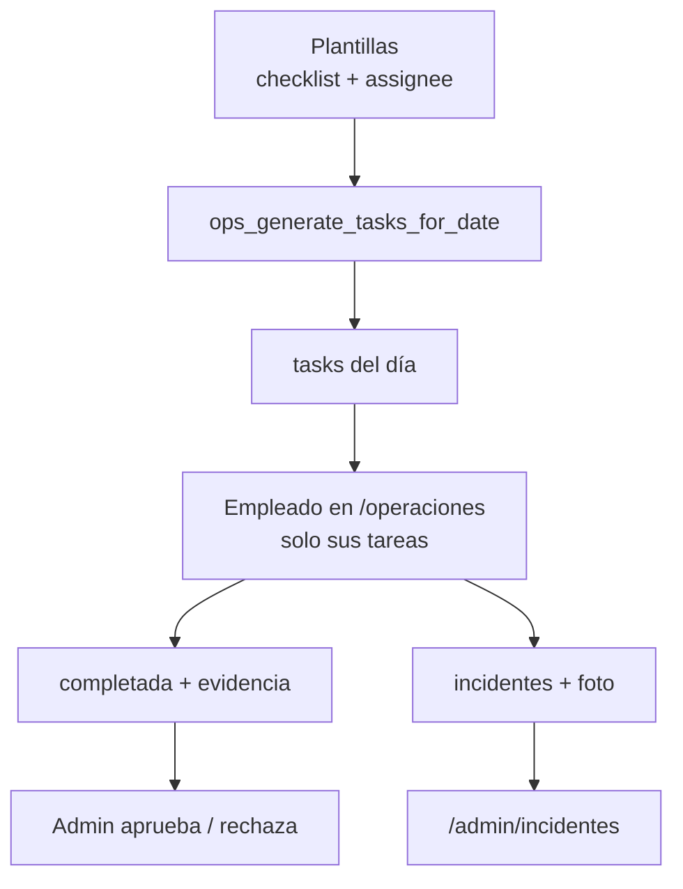

Estados típicos de tarea: `pending → in_progress → completed → approved|rejected`.

### 6.3 Planilla quincenal

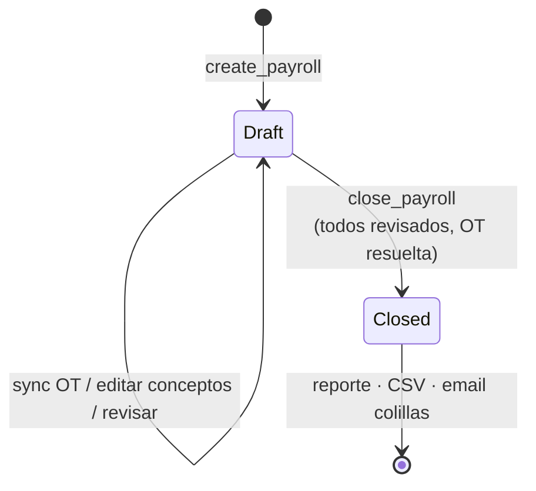

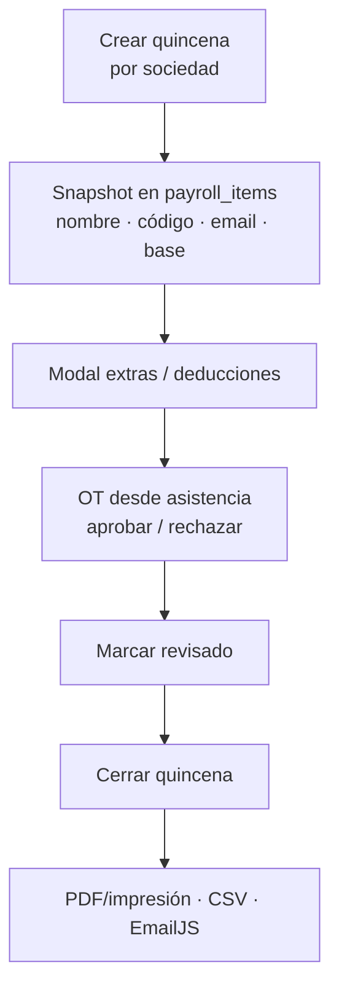

**Importante:** la planilla guarda **snapshots**. Cambiar el salario del empleado después **no** recalcula quincenas ya creadas.

### 6.4 Recordatorios / empleados / aguinaldo

- Empleados: directorio + modal (CRUD vía RPC).
- Recordatorios: lista + modal + documentos.
- Aguinaldo: corrida anual paralela a quincenas (migraciones `aguinaldo_*`).

---

## 7. Patrones de diseño usados

| Patrón | Dónde se ve |
|---|---|
| **Server Components + Actions** | Lectura en page, escritura en actions |
| **Command** | Cada Server Action = un comando |
| **Gateway / Guard** | `requireRole`, RLS |
| **Transaction Script en DB** | RPC `security definer` con locks |
| **Validation at boundary** | Zod en `lib/schemas.ts` |
| **Snapshot** | `payroll_items` al crear corrida |
| **Colocation por feature** | Rutas `/admin/planilla`, `/marcacion`… |
| **Lista → Modal** | empleados, plantillas, planilla, recordatorios |
| **Presentational UI kit** | `admin-ui`, `kpi-card`, `badge`, shell |

---

## 8. Datos: convenciones

- **Dinero:** centavos enteros (`*_cents`), formato CRC en UI.
- **Fechas operativas:** `America/Costa_Rica`.
- **Timestamps:** con zona en DB.
- **Auditoría:** triggers → `audit_log` (sin PINs).
- **RLS:** `authenticated` lee lo permitido; escrituras sensibles vía RPC.

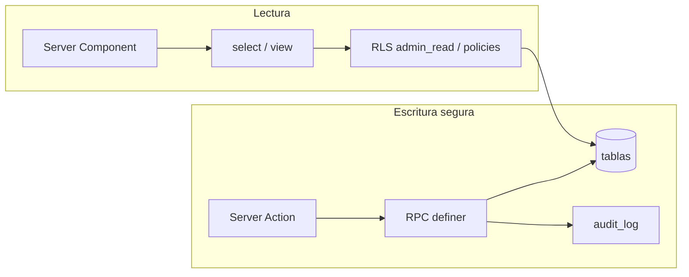

---

## 9. Cómo escalar sin spaghetti

### 9.1 Qué escalar primero (producto)

| Crecimiento | Estrategia |
|---|---|
| Más empleados / sociedades | Ya hay multi-compañía (`COMPANIES`); paginar listados |
| Más pantallas admin | Nuevas rutas bajo `app/admin/<feature>` + actions propias |
| Más reglas de planilla | Nuevas RPC + migraciones; no meter fórmulas en JSX |
| Email / notificaciones | `lib/mail/*` + cola luego si supera ~cientos/día |
| App empleado (fase 2) | Auth por empleado + PWA; reutilizar RPC |

### 9.2 Refactors de estructura (cuando duela)

Hoy `src/app/admin/actions.ts` concentra muchas mutaciones. Cuando crezca, partir por **bounded context**:

```text
src/app/admin/
  employees/actions.ts
  payroll/actions.ts
  attendance/actions.ts
  …o
src/features/payroll/
  actions.ts
  components/
  types.ts
```

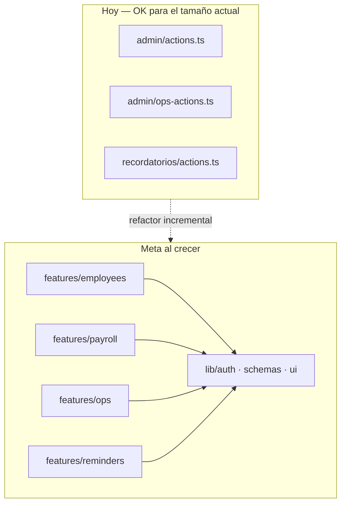

### 9.3 Checklist anti-spaghetti (PR)

1. ¿La mutación pasa por Server Action + Zod?
2. ¿La regla de dinero/seguridad está en RPC (o testada ahí)?
3. ¿El componente solo presenta / dispara comandos?
4. ¿Hay `revalidatePath` de las rutas afectadas?
5. ¿Migración nueva en lugar de editar a mano prod?
6. ¿Evitas un “utils.ts” infinito? Preferí `lib/<dominio>`.

### 9.4 Escalado técnico (infra)

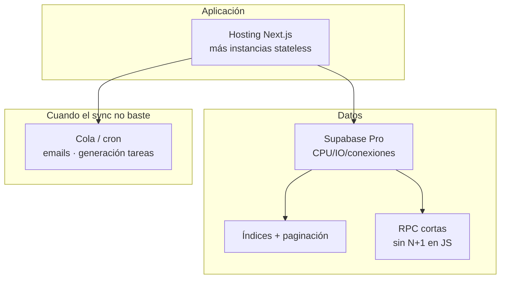

- **Next.js escala horizontal** (stateless) sin problema.
- El cuello real suele ser **DB**: índices, paginación (hoy varios listados top-100), RPC eficientes.
- Emails (~30/mes): EmailJS está bien; si crece, cola + proveedor transaccional.
- Generación diaria de tareas: botón manual hoy; `pg_cron` / Edge Function después.

### 9.5 Lo que NO hacer

- Meter lógica de cierre de planilla o OT solo en el cliente.
- Escribir a tablas sensibles con el client sin RPC cuando existe procedimiento.
- Duplicar fórmulas de CCSS/neto en tres archivos distintos.
- Un único CSS/archivo de actions que absorba todos los features nuevos sin cortar.
- Aceptar `p_occurred_at` sin ventana ni rol kiosk (abuso de reloj).

---

## 10. Decisiones vigentes (resumen)

1. PostgreSQL + RPC es la autoridad; Next orquesta.
2. Snapshots en planilla; no recalcular historial al cambiar salario.
3. Revisión explícita antes de cerrar; no cierre anticipado.
4. Centavos enteros; zona `America/Costa_Rica`.
5. Kiosk Auth ≠ sesión de empleado (código+PIN).
6. PWA (Serwist) para instalación; SW desactivado en dev.
7. Colillas: envío post-cierre vía EmailJS (Gmail del cliente).
8. Marcación offline: IndexedDB en tablet kiosco + RPC con `p_occurred_at` limitado.

---

## 11. Mapa mental de pantallas

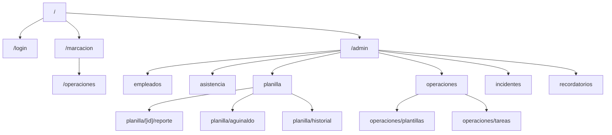

---

## 12. Próximos pasos de arquitectura (opcionales)

1. Partir `admin/actions.ts` por dominio.
2. Paginar turnos / asistencia / auditoría.
3. Historial de salarios con vigencia.
4. Cron de `ops_generate_tasks_for_date`.
5. Tests e2e en Supabase real + tablet.
6. Mantener este documento al agregar un feature grande (1 diagrama + 5 líneas de decisión).

---

*Documento vivo. Si cambia un flujo crítico (marcación, cierre de planilla, roles), actualizá la sección correspondiente y el diagrama Mermaid asociado.*
