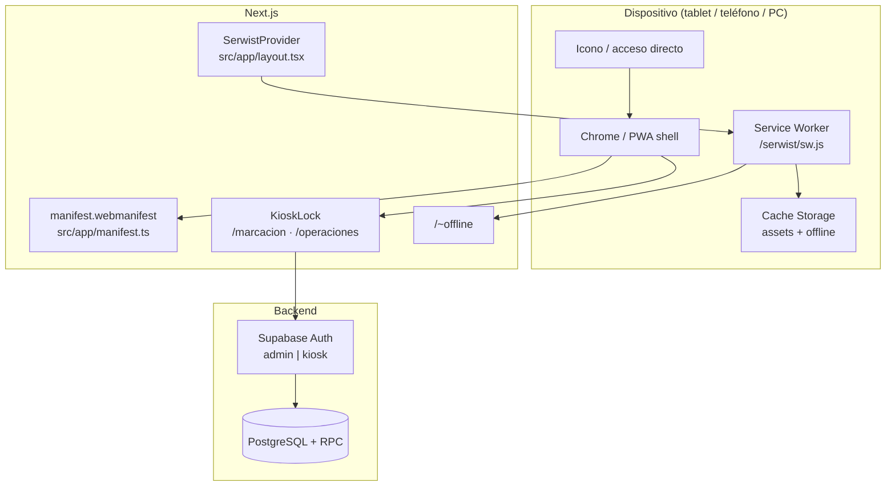
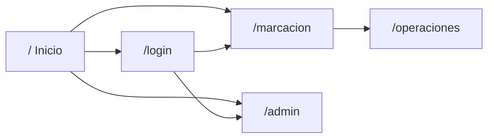
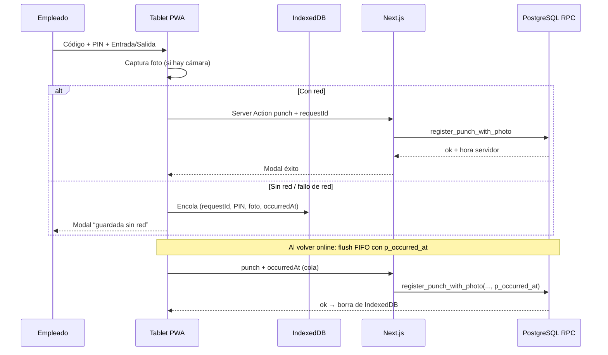

# PWA — Gasolinera Río Tempisque

Documentación de la Progressive Web App: qué es, cómo funciona, qué pantallas cubre, qué datos recolecta y cómo usarla en tablet Android (modo kiosco).

---

## 1. Qué es esta PWA

La aplicación web se puede **instalar** en el dispositivo (Android / iOS / escritorio) y abrirse como una app nativa:

- Sin barra de URL (modo `standalone`)
- Icono en la pantalla de inicio
- Accesos directos a **Marcación** y **Operaciones**
- Service Worker (Serwist) para assets en caché y página offline
- Optimizaciones específicas para **tablet de marcación** anclada

No reemplaza App Store / Play Store: se instala desde el navegador (Chrome, Edge, Safari).

---

## 2. Arquitectura PWA (cómo está armada)



| Pieza | Archivo / ruta | Función |
|---|---|---|
| Manifest | `src/app/manifest.ts` → `/manifest.webmanifest` | Nombre, iconos, `standalone`, atajos |
| Registro SW | `SerwistProvider` en `src/app/layout.tsx` | Registra `/serwist/sw.js` (solo producción) |
| Service Worker | `src/app/sw.ts` + `src/app/serwist/[path]/route.ts` | Precache + runtime cache + fallback offline |
| Iconos | `public/icons/*` | 192, 512, maskable, apple-touch, favicon |
| Offline UI | `src/app/~offline/page.tsx` | Pantalla “Sin conexión” |
| Kiosco | `src/components/kiosk-lock.tsx` + layouts | Bloqueo de gestos / historial en tablet |
| Proxy | `src/proxy.ts` | Refresco de sesión; excluye `/serwist` e `/icons` del `no-store` |

---

## 3. Manifest — identidad de la app

Definido en `src/app/manifest.ts`:

| Campo | Valor |
|---|---|
| `name` | Gasolinera Río Tempisque |
| `short_name` | Río Tempisque |
| `start_url` | `/` |
| `scope` | `/` |
| `display` | `standalone` |
| `orientation` | `any` (tablet puede ir vertical u horizontal) |
| `theme_color` / `background_color` | `#0A1628` |
| `lang` | `es-CR` |

### Iconos

| Archivo | Uso |
|---|---|
| `/icons/icon-192.png` | Android / PWA |
| `/icons/icon-512.png` | Splash / alta resolución |
| `/icons/icon-512-maskable.png` | Icono adaptable (safe zone) |
| `/icons/apple-touch-icon.png` | iOS “Agregar a inicio” |
| `/icons/favicon-32.png` | Pestaña del navegador |

Regenerar desde el logo:

```bash
npm run icons:pwa
```

### Accesos directos (shortcuts)

| Nombre | URL | Uso típico |
|---|---|---|
| Marcación | `/marcacion` | Tablet de entrada/salida |
| Operaciones | `/operaciones` | Tareas e incidentes del turno |

En Android, mantener pulsado el icono de la app muestra estos atajos.

---

## 4. Service Worker (Serwist)

### Comportamiento

- **Producción** (`next build` + `next start` / Netlify): SW activo.
- **Desarrollo** (`next dev`): SW **desactivado** a propósito (`disable={NODE_ENV==="development"}`).

### Estrategia

1. **Precache** del build (HTML/JS/CSS críticos) + `/~offline`.
2. **Runtime caching** con `defaultCache` de Serwist (estáticos, etc.).
3. **Fallback de navegación**: si no hay red al pedir un documento → `/~offline`.
4. `skipWaiting` + `clientsClaim`: actualiza el SW sin esperar a cerrar todas las pestañas.
5. `cacheOnNavigation={false}` en el provider: no cachea agresivamente cada página admin (evita datos viejos de planilla).

### Qué NO hace el SW hoy

- No implementa push notifications.
- La cola de marcaciones offline **no** vive en el Service Worker: usa **IndexedDB** en la página de marcación (ver §8).

---

## 5. Funciones de la PWA por pantalla



### 5.1 Inicio `/`

Landing con logo y dos entradas: Marcación y Administración.

### 5.2 Login `/login`

- Cuenta **kiosk** → redirige a `/marcacion` (con `replace`, no deja login en el historial).
- Cuenta **admin** → `/admin`.

### 5.3 Marcación `/marcacion` (tablet)

Requiere rol Auth `kiosk`.

| Función | Detalle |
|---|---|
| Reloj | Hora Costa Rica en vivo |
| Código + PIN | Solo numéricos; teclado numérico en móvil |
| Entrada / Salida | Botones grandes |
| Foto | Cámara frontal al confirmar (evidencia) |
| Idempotencia | `requestId` UUID por intento |
| Cola offline | Sin red (o fallo de red): guarda en IndexedDB y sincroniza al volver |
| KioskLock | Sin swipe lateral / zoom / gesto atrás a login |
| Enlace | A `/operaciones` para tareas del turno |

### 5.4 Operaciones `/operaciones` (tablet + PIN empleado)

1. Login kiosk Auth (dispositivo).
2. Empleado se identifica con **código + PIN** → cookie `grt_ops_session`.
3. Ve **solo sus tareas** del día; puede completar checklist, adjuntar foto y reportar incidentes.
4. También usa `KioskLock` (misma tablet).

### 5.5 Admin `/admin/*`

Panel completo (empleados, asistencia, planilla, ops, recordatorios…). Es usable en PWA instalada, pero **sin** `KioskLock` (el admin necesita navegación normal).

### 5.6 Offline `/~offline`

Si el service worker no puede servir una navegación por falta de red, muestra esta pantalla con opción de reintentar.

---

## 6. Modo kiosco en tablet Android

### Objetivo

Tablet fija en el mostrador:

- App instalada (PWA)
- Acceso directo a Marcación
- App **anclada** (App pinning) para que no se cierre fácil
- Pantalla que **no se desplace a los lados** ni vuelva al login con el gesto atrás

### Capas de protección

| Capa | Qué hace |
|---|---|
| **Android App pinning** | Impide salir a otras apps sin PIN del dueño |
| **Viewport kiosco** | `maximumScale=1`, `userScalable=false` en layouts de marcación/operaciones |
| **CSS `kiosk-locked`** | `overflow-x: hidden`, `overscroll-behavior: none`, `touch-action` restringido |
| **KioskLock JS** | Bloquea pinch, pan horizontal y **trampa de historial** (gesto atrás) |
| **Login `replace`** | Tras entrar como kiosk, el login no queda detrás en el historial |

### Cómo instalar / configurar (Android)

1. Abrí el sitio en **Chrome** (HTTPS).
2. Menú → **Instalar aplicación** / Agregar a inicio.
3. Abrí la PWA (no la pestaña de Chrome).
4. Iniciá sesión con la cuenta **kiosk**.
5. (Opcional) Usá el acceso directo **Marcación**.
6. Ajustes Android → Seguridad → **Fijar apps** / App pinning → anclá la PWA.
7. Bloqueá rotación si querés orientación fija.

### Limitación conocida

El gesto “atrás” es del sistema Android. La app **intercepta** el historial para quedarse en marcación; no puede desactivar del todo el indicador visual del sistema. El anclaje de apps es la capa que evita salir de la PWA.

---

## 7. Datos que colecta (privacidad operativa)

La PWA en sí no es un tracker de marketing. Los datos vienen del uso del sistema (asistencia, ops, admin).

### 7.1 Datos de autenticación (dispositivo)

| Dato | Dónde | Quién |
|---|---|---|
| Sesión Supabase Auth | Cookies httpOnly (SSR) | Cuenta `admin` o `kiosk` |
| Claims / refresh | `src/proxy.ts` | Automático |
| Cookie ops `grt_ops_session` | Cookie httpOnly, ~8 h | Empleado tras código+PIN en `/operaciones` |

**No se almacenan** contraseñas ni PIN en texto plano en el cliente. El PIN se valida en RPC con hash bcrypt en servidor.

### 7.2 Marcación (`/marcacion`)

| Dato | Uso | Persistencia |
|---|---|---|
| Código de empleado | Identificar persona | Enviado al RPC; no se guarda en localStorage |
| PIN (4 dígitos) | Autenticar empleado | Solo en memoria del formulario; validación server-side |
| Tipo de marca | `entry` / `exit` (/ descansos si aplica) | `attendance_events` |
| Hora | Siempre **hora del servidor** | `occurred_at` |
| `requestId` (UUID) | Evitar doble marca | Idempotencia en DB |
| Foto JPEG | Evidencia de que la persona marcó | `punch_photos` (bytea), retención **30 días**, solo admin puede ver |
| Estado de cámara | Si falló la foto | `punch_photos.status = missing` + alerta admin |

Al marcar también puede actualizarse el contador de intentos fallidos del **dispositivo kiosk** (`devices`).

### 7.3 Operaciones (`/operaciones`)

| Dato | Uso |
|---|---|
| Código + PIN | Abrir sesión de empleado |
| Completar ítems de checklist | Estado de tarea |
| Foto de evidencia de tarea | `task_evidence` |
| Incidente (categoría, severidad, nota, foto) | `incidents` + evidencia |

### 7.4 Admin (si usa la PWA)

Todo lo habitual del panel: empleados (nombre, cédula, correo, salario…), planilla, recordatorios, documentos, etc. Misma base de datos; no hay telemetría extra por ser PWA.

### 7.5 Caché del Service Worker

| Qué puede quedar en el dispositivo | Qué no |
|---|---|
| JS/CSS/HTML estáticos, iconos, `/~offline` | Tokens / listados admin en Cache Storage de negocio |
| Cola IndexedDB `grt-kiosk` (código, PIN, foto, hora) hasta sync | Listados admin en vivo (`cacheOnNavigation=false`) |

Las cookies de sesión sí viven en el dispositivo (estándar web). El PIN en cola offline se borra al sincronizar con éxito; la tablet debe ser de uso exclusivo kiosco.

### 7.6 Lo que la PWA **no** colecta hoy

- Ubicación GPS
- Micrófono
- Contactos / archivos del dispositivo (salvo lo que el usuario adjunta en recordatorios/admin)
- Analytics de terceros (Google Analytics, etc.)
- Push notifications

### 7.7 Permisos del navegador

| Permiso | Pantalla | Motivo |
|---|---|---|
| **Cámara** | Marcación, Operaciones | Foto de evidencia |
| Cookies / almacenamiento | Toda la app | Sesión Auth y ops |

Declarado en headers: `Permissions-Policy: camera=(self), microphone=(), geolocation=()` (`next.config.ts`).

---

## 8. Flujo de marcación (resumen)



### Cola offline (tablet)

| Pieza | Detalle |
|---|---|
| Almacén | IndexedDB `grt-kiosk` / store `punch_queue` (`src/lib/offline-punches.ts`) |
| Cuándo encola | `navigator.onLine === false` o excepción al llamar `punch` |
| Hora | `occurredAt` de la tablet; RPC acepta `p_occurred_at` (máx. 2 min futuro / 72 h pasado) |
| Sync | Eventos `online`, `visibilitychange`, poll 30 s; orden FIFO |
| Errores de negocio | Quedan `failed` (no reintentan solos; botón Reintentar) |
| Migración | `supabase/migrations/202611140001_offline_punch.sql` |

Con red y éxito: se usa la **hora del servidor** (no se envía `occurredAt`).

---

## 9. Archivos clave (mapa rápido)

```text
src/app/manifest.ts                 Manifest PWA
src/app/layout.tsx                  SerwistProvider + metadata
src/app/sw.ts                       Lógica del service worker
src/app/serwist/[path]/route.ts     Sirve /serwist/sw.js
src/app/~offline/page.tsx           UI offline
src/app/marcacion/layout.tsx        Viewport + KioskLock
src/app/marcacion/terminal.tsx      UI kiosco + cola offline
src/app/marcacion/actions.ts        Server Action punch
src/lib/offline-punches.ts          IndexedDB cola de marcas
src/app/operaciones/layout.tsx      Viewport + KioskLock
src/components/kiosk-lock.tsx       Gestos + trampa historial
public/icons/                       Iconos PWA
scripts/generate-pwa-icons.mjs      Genera iconos desde logo
supabase/migrations/202611140001_offline_punch.sql
```

---

## 10. Despliegue y requisitos

1. Sitio en **HTTPS** (obligatorio para PWA e instalación).
2. Variables de entorno en el host (Supabase, EmailJS, etc.).
3. Build de producción (`npm run build`) para que exista el SW.
4. En Netlify, no poner como “secret” valores públicos tipo nombre de marca (ver `netlify.toml` / secrets scan).

### Actualizar la PWA en la tablet

Tras un deploy:

1. Abrí la app instalada.
2. Si no refresca sola, cerrala por completo y volvé a abrirla (SW con `skipWaiting`).
3. Si el icono/manifest no cambia, desinstalá y reinstalá la PWA.

---

## 11. Roadmap PWA (pendiente / posible)

| Idea | Estado |
|---|---|
| Instalar y usar en tablet kiosco | ✅ |
| Offline UI básica | ✅ |
| Bloqueo gestos / historial en marcación | ✅ |
| Cola offline de marcaciones con conciliación | ✅ IndexedDB + `p_occurred_at` (ventana 72 h) |
| Push al admin (OT, alarmas) | ❌ |
| PWA con cuenta Auth por empleado | ❌ (fase 2 del README) |
| Modo fullscreen dedicado solo kiosco | Parcial (`standalone` + pinning) |

---

## 12. Checklist operativo tablet

- [ ] PWA instalada desde Chrome (HTTPS)
- [ ] Login con usuario **kiosk**
- [ ] Permiso de **cámara** concedido
- [ ] Migración `202611140001_offline_punch` aplicada en Supabase
- [ ] Probar marca con modo avión → banner cola → volver red → sync
- [ ] Acceso directo a Marcación (opcional)
- [ ] App pinning activado
- [ ] Wi‑Fi estable (sin red no hay marca)
- [ ] Probar entrada/salida y ver la foto en admin/asistencia

---

*Documento vivo. Si cambian Serwist, el manifest o el modo kiosco, actualizá este archivo junto con el cambio de código.*
